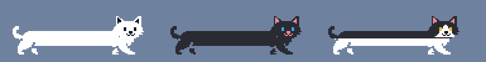

# Catbar

Changes the YouTube seek bar into a funny cat.



The cat's back half sits at 0:00, its head follows the playback position, and its body stretches as the video goes on.

[日本語の説明はこちら](#日本語)

## Features

- The cat stretches as the video plays. Click the bar or drag the cat's head to seek.
- Faces: normal while playing, eyes closed with "Zzz" when paused, round eyes while you drag.
- Three cats: white, black, and tuxedo (hachiware).
- Every 3 minutes of playback, the cat says something in a speech bubble (in Japanese; some of it is sarcastic).
- A faint line shows the whole bar, so you can see where to click. The brighter part shows how much has loaded. Hover it to see the time at that position.
- Works on regular videos and YouTube Shorts.
- Live streams and ads keep the normal seek bar.
- Also works on Twitch VODs and clips (experimental).

## Install (Chrome / Edge)

Catbar is not on the Chrome Web Store. Load it as an unpacked extension:

1. Download this repository (Code → Download ZIP) and unzip it, or `git clone` it.
2. Open `chrome://extensions` (Edge: `edge://extensions`).
3. Turn on **Developer mode**.
4. Click **Load unpacked** and choose the folder that contains `manifest.json`.
5. Open a YouTube video or Short. Reload any YouTube tabs that were already open.

Click the toolbar icon to open the settings: turn the cat on/off, pick a cat, change its size (1x–3x), and turn the speech bubbles on/off.

## Privacy

Catbar collects no data and makes no network requests. It only asks for the `storage` permission, to save your settings.
It only changes how the seek bar looks. It does not touch the video, ads, or the site's network traffic.

## Development

| Path | What it is |
| --- | --- |
| `src/geometry.js` | Layout math and face selection (pure functions) |
| `src/catbar.js` | Draws the cat and handles clicks and drags |
| `src/lines.js` | The cat's lines and the random picker (never repeats any of the last 5) |
| `src/adapters/` | Site-specific code (YouTube, Twitch) |
| `src/content.js` | Startup and settings |
| `popup/` | The settings popup |
| `prototype/index.html` | Try the cat with a local video file, no extension needed |
| `tools/recolor.py` | Makes the black and tuxedo cats by recoloring the white cat |

Run the tests (Node.js 18 or later):

```
node --test tests/geometry.test.js tests/lines.test.js
```

Regenerate the black and tuxedo cats after editing `assets/white/` (needs Pillow):

```
python tools/recolor.py
```

## License

[MIT](LICENSE)

## Disclaimer

Catbar is an unofficial fan project. It is not affiliated with, endorsed by, or sponsored by YouTube, Google, or Twitch.
YouTube is a trademark of Google LLC, and Twitch is a trademark of Twitch Interactive, Inc.

---

## 日本語

YouTube のシークバーを、再生とともに体が伸びる猫に置き換える Chrome 拡張です。

- 下半身はバーの始端（0:00）、上半身は現在の再生位置。間の胴体が伸びていきます
- バーのクリックや、猫の頭のドラッグでシークできます。バーの全体は薄い線で表示され、読み込み済みの部分は少し明るくなります
- 表情: 再生中は通常、一時停止中は目を閉じて Zzz、ドラッグ中は丸目
- 猫の種類: 白猫・黒猫・八割れ
- 再生3分ごとに、猫が吹き出しでしゃべります（直近5つと同じセリフは出ません）
- 通常の動画と YouTube ショートで使えます
- ライブ配信と広告の再生中は、元のシークバーのままです
- Twitch の VOD とクリップにも対応しています（試験的）

### インストール

1. このリポジトリをダウンロード（Code → Download ZIP）して展開する
2. `chrome://extensions`（Edge は `edge://extensions`）を開く
3. 「デベロッパー モード」をオンにする
4. 「パッケージ化されていない拡張機能を読み込む」で、`manifest.json` のあるフォルダを選ぶ
5. YouTube の動画かショートを開く（開いていたタブは再読み込みする）

ツールバーのアイコンから設定画面を開き、ON/OFF・猫の種類・大きさ・おしゃべりの ON/OFF を切り替えられます。

### プライバシー

データの収集や外部への通信は一切行いません。要求する権限は、設定を保存するための `storage` だけです。

### 免責事項

本拡張は非公式のファン作品で、YouTube・Google・Twitch とは関係ありません。YouTube は Google LLC の、Twitch は Twitch Interactive, Inc. の商標です。
